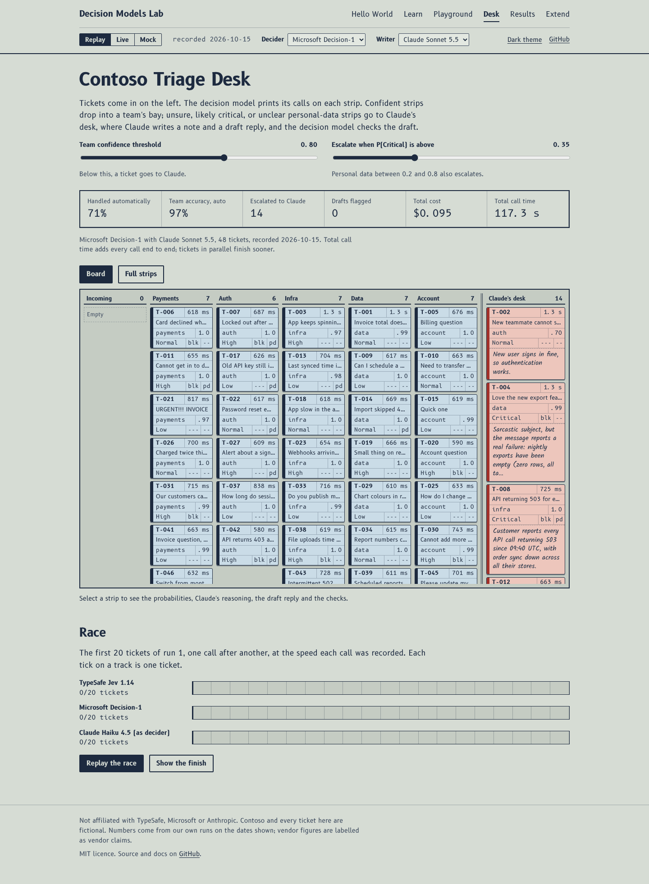
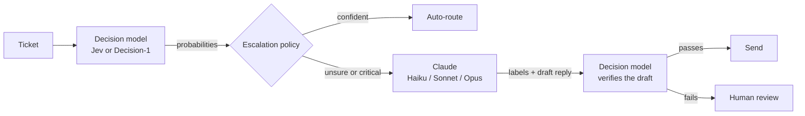

# Decision Models Lab

Fast decisions with Jev and Decision-1, careful reasoning with Claude, and a clear rule for when to hand over.

[](https://github.com/shashikantdev3/decision-models-lab/actions/workflows/ci.yml)
[](LICENSE)
[](https://shashikantdev3.github.io/decision-models-lab/)



## What you will learn

- What a decision model is, and how it differs from asking a chat model.
- The three question types (`noul`, `choice`, `score`) and how to write them well.
- How to combine a fast decision model with Claude: decide, escalate, reason, verify.
- How to choose a confidence threshold from data instead of guessing.
- How to measure what matters: accuracy, calibration, wording sensitivity, speed and cost.

## Decision models in 60 seconds

You send context and a set of typed questions. The model returns a probability for every allowed answer, in one pass, returns a few output tokens, and charges for input tokens only.

```text
in:   state     ["Ticket: Checkout returns HTTP 500 for all users since 10:05."]
      questions urgent (noul), team (choice: payments | auth | infra), severity (score: Cosmetic..Critical)

out:  urgent    noul 0.97
      team      choice payments, confidence 0.91, { payments 0.94, auth 0.01, infra 0.05 }
      severity  score 2.87, { Cosmetic 0.00, Minor 0.02, Major 0.09, Critical 0.89 }
      usage     212 tokens in, 2 out
```

(Values above illustrate the documented response shape; they are not a measurement.)

| Model                | Pinned id                                 | Context        |
| -------------------- | ----------------------------------------- | -------------- |
| TypeSafe Jev 1.14    | `typesafe/jev-1.14`                       | 262,144 tokens |
| Microsoft Decision-1 | `microsoft/microsoft-decision-1-20261009` | 32,768 tokens  |

Both listed at $0.042 per million input tokens, output free, on OpenRouter on 15 October 2026.

## Hello World

Only the model id changes between the two.

```bash
# curl
OPENROUTER_API_KEY=sk-or-... ./examples/hello-world/curl.sh typesafe/jev-1.14

# Python, standard library only
OPENROUTER_API_KEY=sk-or-... python examples/hello-world/hello.py microsoft/microsoft-decision-1-20261009

# TypeScript, with this repo's core library (reads .env)
npm run hello -- --model jev,decision-1
```

No key yet? `npm run hello -- --mock` shows the same flow with an offline stand-in. More in [docs/03-hello-world.md](docs/03-hello-world.md).

## The demo: Contoso Triage Desk

48 fictional support tickets for Contoso arrive in a queue.

1. **Decide (fast).** One decision call per ticket answers team, urgency, customer blocked and personal data.
2. **Route or escalate.** Confident tickets go straight to a team. Unsure ones, likely critical ones and ones with unclear personal data go to Claude.
3. **Reason (slow).** Claude settles the labels, writes a short reason and drafts a reply.
4. **Verify (fast again).** The decision model checks Claude's draft for a non-answer, leaked personal data, unapproved promises and tone. A failed check goes to a person.
5. **Record.** Every step logs model, version, time, tokens and cost.

On the site each ticket is a strip on an air traffic control style board. Printed fields are the fast model's calls; a pencil note is Claude's reasoning. Move the threshold slider and strips slide between the team bays and Claude's desk.

**Live site:** https://shashikantdev3.github.io/decision-models-lab/ (works with no key in Replay and Mock modes; Live mode uses your own keys, held only in the tab's memory).

## Architecture



`packages/core` holds the types, model adapters, escalation policy, pipeline and metrics, and runs in both Node and the browser. `packages/cli` has the `hello`, `bench`, `triage` and `wording` commands. `site/` is the Vite and React site. `config/` lists the models, dated prices and default thresholds. `data/` holds the tickets, question set and dataset card. `results/` holds recorded runs, which power the site's Replay mode. More in [docs/08-architecture.md](docs/08-architecture.md).

## Results snapshot

No live run has been recorded yet. The first recorded run will appear here as a table with its date, pinned model versions and region, and on the [Results page](https://shashikantdev3.github.io/decision-models-lab/#/results). Until then the site shows Mock data with a Mock badge on every number. How every number is produced: [docs/11-results-methodology.md](docs/11-results-methodology.md).

## Limitations

> [!WARNING]
> **Decision-1 reads at most 33K tokens. Jev reads up to 262K.**
> Keep each ticket's context short if you want to compare both fairly. Long inputs will fail on Decision-1 and push Jev into its slower long-context mode (text over about 32,000 bytes).

> [!IMPORTANT]
> **Both models are new and the Decisions API is in alpha.**
> Pin exact versions (`typesafe/jev-1.14`, `microsoft/microsoft-decision-1-20261009`). Aliases like `~typesafe/jev-latest` and `microsoft/microsoft-decision-1` can change behaviour without warning, which also changes any thresholds you tuned.

- **Wording changes answers.** Microsoft's own docs warn that results can change with question wording. The wording test in this repo measures it.
- **No reasons.** Decision models return probabilities, not explanations. If you need to explain a decision to a person, keep a reasoning model in the loop or log the inputs carefully.
- **Confidence is not safety.** A confident answer can be wrong. Choose thresholds from the cost of each kind of mistake, tune them on labelled data, and keep humans on high-impact decisions.
- **Vendor claims are claims.** Speed, cost, "can't hallucinate" and benchmark wins come from the vendors. This repo reports only what it measured, and only on its own small dataset.
- **Text first.** Image questions (box) exist only on Jev 1.14, are an early feature, and run in the slower long-context mode. Decision-1 does not support them.
- **Claude's probabilities are written, not calibrated.** When Claude acts as a decider it writes numbers down. Compare its reliability diagram before trusting them.
- **Keys and cost.** Never put a key in a public site. Live mode keeps keys in your browser session only. Set spending limits on your OpenRouter key and Anthropic workspace.

## Cost

Recorded costs per model will appear here after the first run. Until then, these are **estimates** from `config/pricing.json` (checked 15 October 2026), for one full bench of 48 tickets x 3 runs:

| Model                        | Basis                                                            | Estimate per bench |
| ---------------------------- | ---------------------------------------------------------------- | ------------------ |
| Jev 1.14 or Decision-1       | about 300 input tokens per call, $0.042 per million, output free | under $0.01        |
| Claude Haiku 4.5 as decider  | about 720 in and 160 out per call, $1 / $5 per million           | about $0.25        |
| Claude Sonnet 5.5 as decider | same tokens, $2 / $10 per million                                | about $0.51        |

Spending caps: use a dedicated OpenRouter key with a credit limit, set a monthly limit on your Anthropic workspace, and keep the CLI's `--max-usd` (default $2). The CLI prints its estimate and asks before any run over 10 tickets.

## Run it yourself

Prerequisites: Node 20.12+, git. Python 3.10+ only for `hello.py`.

```bash
git clone https://github.com/shashikantdev3/decision-models-lab.git
cd decision-models-lab
npm install
cp .env.example .env          # add OPENROUTER_API_KEY and, for Claude, ANTHROPIC_API_KEY

npm test                      # unit tests, offline
npm run triage -- --mock      # whole pipeline, offline, no key
npm run hello -- --model jev  # one live call, a fraction of a cent
npm run bench -- --models jev,decision-1,claude-haiku --runs 3
npm run triage -- --decider decision-1 --writer claude-sonnet --threshold 0.8
npm run wording -- --model jev
npm run dev                   # site at http://localhost:5173
```

## Extend it

- **Add a model:** one entry in `config/models.json`; a new adapter only if the API differs. Template in [docs/09-extending.md](docs/09-extending.md).
- **Add a question type:** extend `QuestionType`, the adapter mapping, and one UI widget.
- **Add a dataset:** same JSONL shape plus a dataset card. Ideas: HR requests, IT access requests, content moderation, invoice exceptions, pull-request triage on public repos.
- **Add a chart or metric:** pure functions in `packages/core/src/metrics/`, one Recharts component on the Results page.
- **Add a language:** tickets in Hindi or another language, to test how both models handle it.

## Reuse it

- Import `@decision-models-lab/core` in your own Node or browser app for the adapters, the escalation policy and the metrics. See [docs/10-reusing-the-core.md](docs/10-reusing-the-core.md).
- Copy the escalation pattern: decision model first, LLM on low confidence, decision model to verify the LLM.
- Reuse the dataset format and the bench CLI to evaluate decision models on your own labelled data before you trust a threshold.

## Contribute

See [CONTRIBUTING.md](CONTRIBUTING.md). Good first issues:

1. Add an adapter for Jev box questions with an image example.
2. Add an HR requests dataset with a dataset card.
3. Add a Hindi ticket set and compare results.
4. Add a confusion-matrix chart for `team`.
5. Add a "cost of mistakes" threshold picker (set the cost of a false auto-route, get a suggested threshold).
6. Add an export of a run as CSV.
7. Add a TypeSafe SDK adapter (System One API) and compare it with the Decisions API.
8. Add a clear error panel for rate limits in Live mode.
9. Add keyboard shortcuts to the Triage Desk.
10. Translate the Learn page.

## Roadmap

- Record the first live runs and publish them with dates and versions.
- Owner-reviewed labels for the v1 dataset.
- Demo GIF and short video of the loop, the slider and the race.
- Jev `box` questions with images.
- A second dataset and a Hindi ticket set.
- Publish `@decision-models-lab/core` to npm.

## Sources and acknowledgements

- OpenRouter, [Jev guide](https://openrouter.ai/docs/guides/community/jev) and [Jev tutorial](https://openrouter.ai/docs/guides/community/jev-tutorial)
- OpenRouter, [Decisions API reference](https://openrouter.ai/docs/api/api-reference/alphadecisions/submit-a-decisions-questions-and-answers-request)
- OpenRouter, [Microsoft-Decision-1 model page](https://openrouter.ai/microsoft/microsoft-decision-1) and [Jev Router](https://openrouter.ai/typesafe/jev-router)
- InfoWorld, [Microsoft separates decision-making from generative AI with a new model](https://www.infoworld.com/article/4234290/microsoft-separates-decision-making-from-generative-ai-with-a-new-model.html)
- The New Stack, [TypeSafe Jev "System One"](https://thenewstack.io/typesafe-jev-system-one/)
- SiliconANGLE, [TypeSafe AI exits stealth](https://siliconangle.com/2026-09-16/typesafe-ai-exits-stealth-with-40m-to-build-ai-for-use-by-software/)
- [TypeSafe documentation](https://docs.typesafe.ai) and [Anthropic API documentation](https://docs.claude.com)
- Type: [B612](https://github.com/polarsys/b612) by Airbus and [Kalam](https://fonts.google.com/specimen/Kalam) by Indian Type Foundry

## Disclaimer

Not affiliated with TypeSafe, Microsoft or Anthropic. Contoso and all ticket data are fictional. Numbers are from our own runs on the stated dates; vendor figures are labelled as vendor claims. Code under the [MIT licence](LICENSE); dataset under CC BY 4.0.
