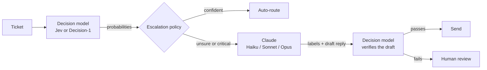

# System One and System Two

The demo uses a fast model and a slow model together, and lets each do what it is good at.

1. **Decide.** One decision call per ticket answers `team`, `urgency`, `customer_blocked` and `contains_personal_data`.
2. **Route or escalate.** `route()` in `packages/core/src/policy/escalation.ts` reads the probabilities. See [05-thresholds-and-escalation.md](05-thresholds-and-escalation.md).
3. **Reason.** Escalated tickets go to Claude (`ClaudeWriter`). Claude gets the ticket and the decision model's probabilities and returns final labels, a short reason and a draft reply, through a forced tool call so the output is structured. The system prompt forbids repeating personal data and promising refunds or dates.
4. **Verify.** The decision model checks the draft with four questions from `data/questions.v1.json`: `reply_answers_the_question`, `reply_leaks_personal_data`, `reply_promises_something_unapproved` and `reply_tone`. `checkDraft()` turns those into pass or fail.
5. **Record.** Every step keeps its model id, latency, tokens and cost in a `TriageRecord`.

The loop is the lesson: the fast model decides, the slow model handles the hard cases, and the fast model checks the slow one. Checking Claude's reply costs about as much as routing the ticket did, a fraction of a cent.

On the site, each ticket is a strip on an air traffic control style board. Printed fields are the fast model's calls; a pencil note is Claude's reasoning.
